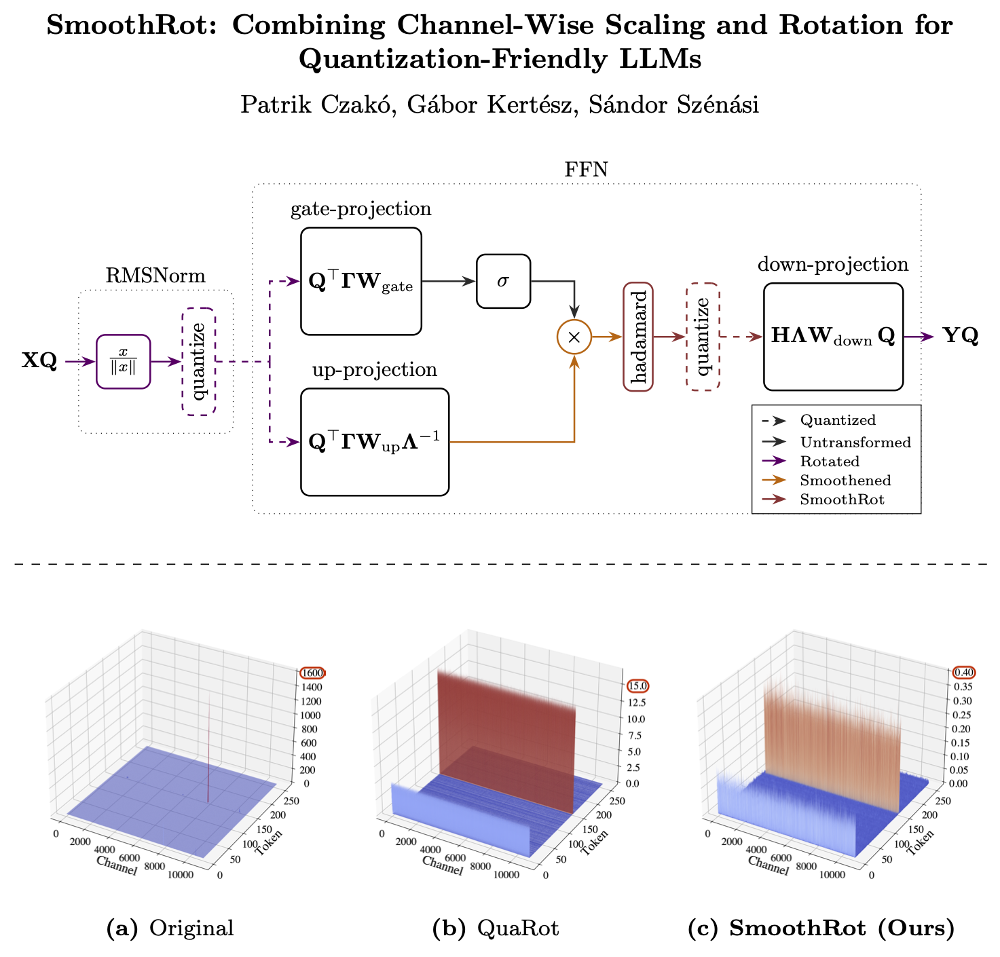
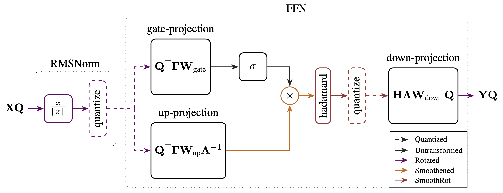
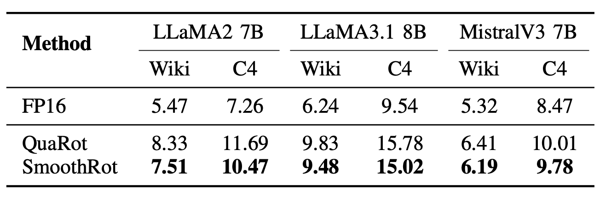
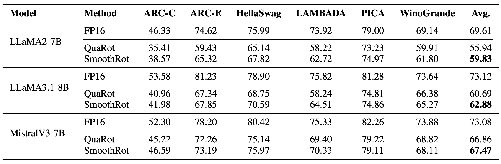

# SmoothRot: Combining Channel-Wise Scaling and Rotation for Quantization-Friendly LLMs

📄 Accepted to *IEEE SMC 2025*

📘 [arXiv:2506.05413](https://arxiv.org/abs/2506.05413)

## Graphical Abstract



## Abstract

We present **SmoothRot**, a novel post-training quantization technique to enhance the efficiency of **4-bit quantization** in Large Language Models (LLMs). SmoothRot addresses the critical challenge of *massive activation outliers* by integrating **channel-wise scaling** (smoothing) with **Hadamard transformations**. Our technique effectively transforms extreme outliers into quantization-friendly activations, significantly improving quantization accuracy. Experiments conducted on popular LLMs (LLaMA2 7B, LLaMA3.1 8B, and Mistral 7B) demonstrate that SmoothRot consistently reduces the performance gap between quantized and FP16 models by approximately **10–30%** across both **language generation** and **zero-shot reasoning** benchmarks, *without introducing additional inference latency*.

## Method Overview

**SmoothRot** extends the [**QuaRot**](https://github.com/spcl/QuaRot) framework by applying **channel-wise scaling before rotation** inside each Feed-Forward Network (FFN) module.
It effectively smooths and redistributes activation outliers via an invertible transformation matrix:

$$A = (H \Lambda)^{-1}$$

where

* **H**: Hadamard matrix (rotation, applied online)
* **Λ**: diagonal scaling matrix (channel-wise, calibrated offline)

### Architecture



**Key components**

* RMSNorm fusion with weight matrices
* Channel-wise scaling absorbed into up-projection weights
* Online Hadamard rotation before down-projection
* Fully quantization-friendly FFN activations

## Experimental Setup

### Models Evaluated

* **LLaMA2-7B**
* **LLaMA3.1-8B**
* **Mistral-7B**

### Tasks

* **Language Generation** – Perplexity (↓) on *Wikitext-2*, *C4*
* **Zero-Shot Reasoning** – Accuracy (↑) on *PIQA*, *ARC-Easy/Challenge*, *HellaSwag*, *LAMBADA*, *WinoGrande*

### Quantization Settings

| Component   | Type            | Bits | Scheme     | Clipping  |
| ----------- | --------------- | ---- | ---------- | --------- |
| Weights     | Per-channel     | 4    | Symmetric  | Optimized |
| Activations | Per-token       | 4    | Symmetric  | 0.9       |
| KV Cache    | Per-group (128) | 4    | Asymmetric | 0.95      |

Migration strength α optimized via linear search per model:
`0.6 (LLaMA2 7B), 0.5 (LLaMA3.1 8B), 0.45 (Mistral 7B)`

Calibration: 512×512 tokens sampled from Wikitext-2, C4, or PTB (takes only a few seconds on a single A100 GPU).

## Main Results

### Language Modeling (Perplexity ↓)



SmoothRot narrows the gap to FP16 by **~30%**.

### Zero-Shot Reasoning (Accuracy %)



SmoothRot outperforms QuaRot across nearly all tasks.

### Ablations

* **Calibration Dataset Dependence:** negligible (<0.3 PPL variation)
* **Migration Strength (α):** optimal near 0.5
* **GPTQ + SpinQuant Compatibility:** fully compatible, no added latency

## Usage

### Installation

```bash
pip install -r requirements.txt
```

### Environment Variables

Copy `.env.example` → `.env` and set:

| Variable        | Required | Description                                  |
| --------------- | -------- | -------------------------------------------- |
| `HF_TOKEN`      | yes      | Hugging Face token for model download        |
| `WANDB_API_KEY` | no       | Log activations & scales to Weights & Biases |

### Running Experiments

#### Example Command

```bash
python main.py \
  --model meta-llama/Llama-3.2-1B \
  --seqlen 2048 \
  --eval_samples 8 \
  --lm_eval_tasks lambada \
  --batch_size 1 \
  --device cuda
```

#### CLI Options

| Argument                                       | Description                            | Default                    |
| ---------------------------------------------- | -------------------------------------- | -------------------------- |
| `--model`                                      | Model name                             | `meta-llama/Llama-2-7b-hf` |
| `--batch_size`                                 | Batch size                             | 1                          |
| `--seqlen`                                     | Sequence length                        | 2048                       |
| `--eval_dataset`                               | Datasets for perplexity eval           | `wikitext2`                |
| `--lm_eval`                                    | Run LM Evaluation Harness              | –                          |
| `--quantize`                                   | Apply quantization                     | –                          |
| `--a_bits`, `--w_bits`, `--k_bits`, `--v_bits` | Bit precision                          | 4                          |
| `--smooth`                                     | Apply smoothing (channel-wise scaling) | –                          |
| `--smooth_alpha`                               | Smoothing strength α                   | 0.5                        |
| `--rotate`                                     | Apply rotation (Hadamard)              | –                          |
| `--spinquant`                                  | Use SpinQuant rotation                 | False                      |
| `--wandb`                                      | Enable WandB logging                   | False                      |

### Docker Usage

Run experiments easily inside Docker:

```bash
docker run --rm -it \
  --gpus all \
  czakop/smoothrot:0.2.4 \
  python main.py \
  --model meta-llama/Llama-2-7b-hf \
  --seqlen 2048 \
  --batch_size 8 \
  --device cuda \
  --eval_samples 64
```

## Reproducibility

* Fully deterministic given the same random seed (`--seed`)
* No fine-tuning required — **pure PTQ**
* Calibration runs in seconds on a single A100 GPU
* Zero added latency compared to QuaRot

Here’s a concise **Foundations & Related Work** section using only the technique names as GitHub-linked items:

## Foundations & Related Work

SmoothRot builds upon several key open-source quantization techniques:

* [**SmoothQuant**](https://github.com/mit-han-lab/smoothquant) — Channel-wise scaling to smooth activation outliers.
* [**QuaRot**](https://github.com/spcl/QuaRot) — Rotation-based quantization using Hadamard transformations.
* [**SpinQuant**](https://github.com/facebookresearch/SpinQuant) — Learned rotations for quantization with optimized orthogonal matrices.
* [**GPTQ**](https://github.com/IST-DASLab/gptq) — Second-order gradient-based post-training weight quantization.
* [**QuIP#**](https://github.com/Cornell-RelaxML/quip-sharp) — Orthogonal transformation and lattice-codebook–based quantization for improved incoherence.

## Citation

If you use SmoothRot in your research, please cite:

```bibtex
@article{czako2025smoothrot,
  title={SmoothRot: Combining Channel-Wise Scaling and Rotation for Quantization-Friendly LLMs},
  author={Czakó, Patrik and Kertész, Gábor and Szénási, Sándor},
  journal={arXiv preprint arXiv:2506.05413},
  year={2025},
  note={To appear in IEEE SMC 2025 Proceedings}
}
```
